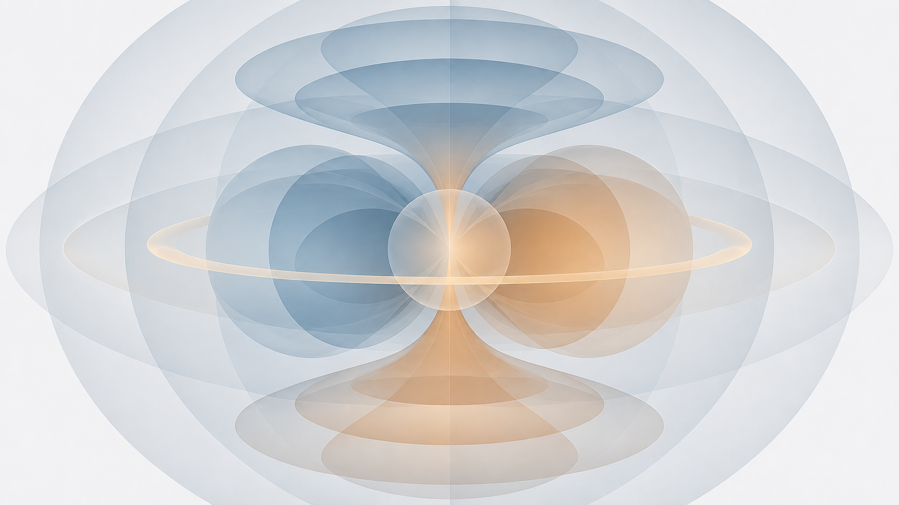
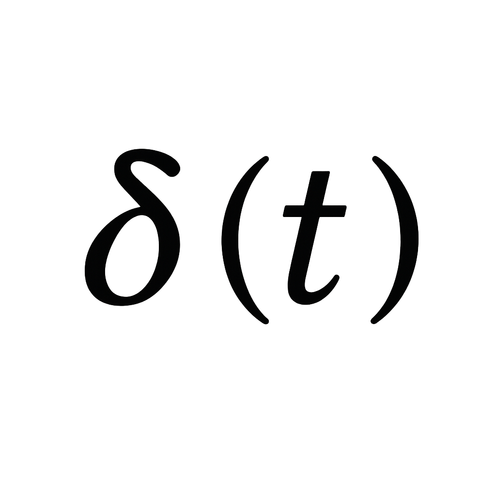

# spacetime-sym

[](https://github.com/bogdan-tanygin/spacetime-sym/actions/workflows/build.yml)
[](https://bogdan-tanygin.github.io/spacetime-sym/)
[](https://coveralls.io/github/bogdan-tanygin/spacetime-sym?branch=main)



**Symmetry groups and physical-quantity invariance in Python.**

`spacetime-sym` is a scientific Python library for constructing symmetry operations and groups, describing the transformation properties of physical quantities, and testing their invariance. It combines spatial transformations in **O(3)** (including **SO(3)** rotations and reflections) with discrete symmetry labels such as **P**, **T**, and a symbolic **C**. The emphasis is on symmetry analysis **beyond periodic crystal structures**.

### Highlights

- **Physical-quantity-centric:** scalars, pseudoscalars, polar and axial vectors, and second-rank tensors with distinct transformation properties.
- **Groups from generators:** finite spatial and magnetic symmetry groups, including rotations, reflections, and time reversal.
- **Curie limiting groups:** selected continuous symmetries and invariance checks without sampling every rotation angle.
- **Reproducible examples:** finite and limiting-group cases in the [documentation](https://bogdan-tanygin.github.io/spacetime-sym/) and [unit tests](tests/unit_tests/).

The current `C` label is a simplified dichromatic operation; **Dirac-spinor charge conjugation is not implemented**.

## Installation

**Python 3.12+** is required.

```bash
git clone https://github.com/bogdan-tanygin/spacetime-sym.git
cd spacetime-sym
python -m pip install -e .
```

## Tests

```bash
python -m pip install -e ".[dev]"
python -m pytest tests/unit_tests
```

## Documentation and research

- [Scientific overview and API documentation](https://bogdan-tanygin.github.io/spacetime-sym/)
- [Executable examples in the test suite](tests/unit_tests/)
- [Research background: Tanygin's thesis](https://doi.org/10.5281/zenodo.17573059) and [Hlinka's vectorlike-quantity classification](https://doi.org/10.1103/PhysRevLett.113.165502)

## License, attribution, and contributions

<a href="http://deeptech.business" title="Deeptech">
  <picture>
    <source media="(prefers-color-scheme: dark)" srcset="docs/source/_static/images/dt_logo_white.png">
    <source media="(prefers-color-scheme: light)" srcset="docs/source/_static/images/dt_logo_black.png">
    
  </picture>
</a>

`spacetime-sym` is available under [GPL-3.0-only](LICENSE) **or** a [separate written commercial license](LICENSE-commercial). For commercial use or research partnerships, contact [info@deeptech.business](mailto:info@deeptech.business).

The project builds on [bsym](https://github.com/bjmorgan/bsym) by Benjamin J. Morgan ([JOSS, 2017](https://doi.org/10.21105/joss.00370)); retained upstream code is covered by the original [MIT notices](licenses/bsym-MIT).

Issues, tests, documentation improvements, and pull requests are welcome. Please coordinate licensing of substantial code contributions in advance. See [Issues](https://github.com/bogdan-tanygin/spacetime-sym/issues) and [Pull requests](https://github.com/bogdan-tanygin/spacetime-sym/pulls).
