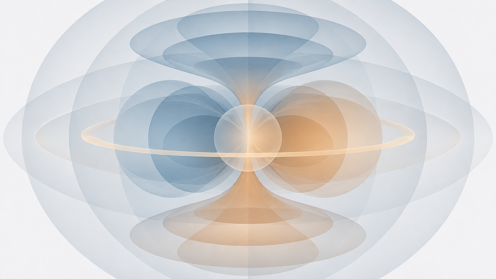

# spacetime-sym

**Spatial and dichromatic point groups, Curie limiting groups, and invariance of physical quantities in Python**



`spacetime-sym` is an open-source Python library for constructing **spatial and dichromatic point groups** and checking the **invariance of physical quantities** under their operations. It represents spatial transformations in $O(3)$, including proper rotations in $SO(3)$ and improper operations such as reflections. These can be combined with dichromatic operations, notably time reversal ($T$); a charge-conjugation ($C$) label is currently symbolic. In addition to finite point groups, the library supports selected continuous Curie limiting groups.

Physical-quantity invariance is the central workflow. A scalar, pseudoscalar, polar or axial vector, or second-rank tensor is tested against a specified group using its spatial and dichromatic transformation character. Thus, the same point group can allow one physical quantity while forbidding another. This point-group approach makes symmetry analysis useful beyond periodic crystallography, including physical observables, order parameters, and material-response tensors.

This documentation begins with two concrete group examples — the continuous polar group $\infty m$ and the finite magnetic point group $6'mm'$ — before introducing the API and the underlying physical conventions. Further executable examples are linked in the test suite below.

## Why symmetry of physical quantities matters

In his 1894 paper *[Sur la symétrie dans les phénomènes physiques, symétrie d'un champ électrique et d'un champ magnétique](https://doi.org/10.1051/jphystap:018940030039300)*, Pierre Curie argued that symmetry methods familiar from crystallography should also be used to analyze physical phenomena. These ideas provide constraints on the properties and responses a system can exhibit, often before solving the equations governing its dynamics.

The same geometric direction does not necessarily imply the same physical transformation law. For example, electric polarization and velocity are both polar vectors, but the former is time-even whereas the latter is time-odd. Magnetization is instead a time-odd axial vector. These distinctions matter when identifying permissible physical responses, order parameters, and interactions.

J. Hlinka's 2014 paper, *[Eight Types of Symmetrically Distinct Vectorlike Physical Quantities](https://doi.org/10.1103/PhysRevLett.113.165502)*, is an important inspiration for this project. It explains why directional quantities cannot all be treated as ordinary polar vectors: alongside polar and axial vectors, the classification includes several kinds of bidirectors, distinguished by their spatial and time-reversal symmetries. Hlinka cites earlier symmetry-based work by Dr. Bogdan Tanygin on magnetic domain walls and topological defects.

`spacetime-sym` grows out of this broader research interest. Its aim is to encourage the use of group-theoretical reasoning for physical quantities, fields, and micromagnetic structures, not only for crystal lattices. A longer treatment of Curie groups, Hlinka's classification, two-dimensional domain walls, one-dimensional line defects, and zero-dimensional point defects, as well as skyrmions and surface effects, will be developed in the Theory section. Specific magnetic examples include Bloch and Néel lines and Bloch points. The group-theoretical treatment follows, in part, [Tanygin's dissertation](https://doi.org/10.5281/zenodo.17573059), especially Section 2 (symmetry of micromagnetic structures).

## What makes spacetime-sym different?

**Core idea:** connect spatial and dichromatic point-group symmetry directly to the transformation law of a physical quantity. Instead of starting from a crystal structure and identifying its crystallographic group, `spacetime-sym` lets researchers construct groups from spatial and reversal operations, specify the transformation character of a scalar, vector, or second-rank tensor, and ask whether that physical quantity is invariant. Selected continuous Curie limiting groups extend this workflow beyond finite rotations. This is useful even when no periodic lattice is involved.

The current implementation brings several features together in a compact, scriptable Python API:

- **Invariance of physical quantities up to tensor rank two.** `PhysicalQuantity` associates a scalar, three-component vector, or second-rank $3\times3$ tensor with explicit spatial and dichromatic transformation factors. Under the *same* point group, a time-even polar vector, time-odd axial vector, pseudoscalar, or tensor may give a different invariance result.
- **Spatial and dichromatic point groups.** User-defined $O(3)$ operations (including $SO(3)$ rotations and improper operations) can be combined with reversal labels such as $T$. Finite point groups can be generated from these operations rather than only selected from crystallographic tables; $6'mm'$ below illustrates a magnetic point group.
- **Selected continuous Curie limiting groups.** Dedicated axial and scalar limiting-group classes test supported invariants without replacing an infinite family of rotations with a finite angular grid. The $\infty m1'$ example below illustrates this difference from ordinary finite-group enumeration.
- **Orientation-independent quantities.** An optional `bidirector` flag treats a quantity and its negative as equivalent for relevant comparisons and invariance tests. This provides a practical representation of unoriented axes, although it does not implement Hlinka's entire eight-type classification as a complete algebra.

### How it relates to other symmetry software

This is a difference in emphasis and workflow, not a claim that the mathematical operations themselves are new. The [Bilbao Crystallographic Server](https://cryst.ehu.es/) offers comprehensive crystallographic and magnetic-symmetry tools, including symmetry-adapted tensors through MTENSOR and the newer STENSOR (2026). [spglib](https://spglib.readthedocs.io/) and [pymatgen](https://pymatgen.org/pymatgen.symmetry.html) provide mature crystal-structure and magnetic-symmetry analysis, including time-reversal operations; [spgrep](https://github.com/spglib/spgrep) focuses on irreducible representations. [MTEX](https://mtex-toolbox.github.io/) provides sophisticated rotation, orientation and crystal-symmetry tools. [Wolfram Language](https://reference.wolfram.com/language/ref/FiniteGroupData.html) supports finite-group computations and [tensor permutation symmetries](https://reference.wolfram.com/language/ref/TensorSymmetry.html), while [MATLAB Symbolic Math Toolbox](https://www.mathworks.com/help/symbolic/) provides a general-purpose symbolic environment. The upstream [bsym](https://github.com/bjmorgan/bsym) primarily targets symmetry-equivalent configurations and their enumeration.

By contrast, `spacetime-sym` is deliberately lightweight and physical-quantity-centric: its principal workflow is to construct a spatial or dichromatic point group, specify the transformation character of a scalar, vector, or second-rank tensor observable, and test its invariance directly in Python, including under selected continuous Curie limiting groups. It is intended to complement, not replace, the more comprehensive crystallographic and computer-algebra systems above.

**Current scope (November 2026):** the numerical API targets classical scalar, vector, and second-rank tensor representations. The `C` flag is a *symbolic* dichromatic label, not Dirac-field charge conjugation; complete spinor transformations, general high-rank tensor representations, automatic symmetry detection from arbitrary spatially varying fields, and exhaustive crystallographic databases are not claimed as implemented. Theoretical applications to domain walls, one-dimensional micromagnetic line defects (including Bloch and Néel lines), zero-dimensional point defects (including Bloch points), skyrmions, and surface effects are research motivations and planned documentation, not a promise that those objects already have dedicated modelling classes.

## Potential applications and research directions

Symmetry analysis can be useful long before a complete microscopic or numerical model is available: it can reject incompatible assumptions, identify admissible order parameters, and reveal which couplings merit further investigation. The following areas range from workflows supported by the present symmetry-operation and invariance API to research opportunities that would require further theoretical or software development.

### Free-energy invariance and constitutive models

A practical application is symmetry validation of proposed free-energy, Landau, and phenomenological coupling terms. A candidate scalar expression should remain invariant under every symmetry of the parent phase or the specified physical environment. This matters for magnetic, ferroelectric, magnetoelectric, toroidal, and flexomagnetoelectric interactions, including couplings involving polarization, magnetization, gradients, and material tensors.

The present API can help check the transformation behavior and invariance of supported constituent quantities and explicitly represented candidate terms. It **does not yet** automatically generate a complete basis of invariant polynomials, parse arbitrary symbolic free-energy functionals, or implement arbitrary high-rank tensor algebra. Such automation is an attractive direction for further development, complementary to established tools such as [ISOTROPY INVARIANTS](https://landau3.byu.edu/invariants.php) and the [Bilbao Crystallographic Server](https://cryst.ehu.es/).

### Ferroics, antiferromagnets, symmetry breaking, and phase transitions

For ferroelectrics, ferromagnets, antiferromagnets, multiferroics, and magnetoelectrics, symmetry groups constrain admissible order parameters, response coefficients, and couplings. Comparing the transformation character of a physical quantity with a candidate high- or low-symmetry group can inform studies of spontaneous symmetry breaking and phase transitions, including questions about which polar, axial, or time-odd properties may appear in a broken-symmetry phase.

A particularly instructive case is an antiferromagnetic order parameter: an object often called an *antiferromagnetic vector* need not transform as an ordinary polar vector. Hlinka's [eight-type classification](https://doi.org/10.1103/PhysRevLett.113.165502) includes time-odd neutral and time-odd chiral bidirectors, illustrating why the type of directional order parameter must be specified rather than inferred from the presence of three numerical components. The existing `bidirector` option provides a limited orientation-equivalence mechanism; a complete implementation of the eight classes and their full algebra is a future research and development goal.

### Chirality and its behavior under time reversal

One motivation is to promote explicit symmetry-based descriptions of chirality, including its response to space inversion, mirror operations, proper rotations, and time reversal. This continues the approach developed in [B. M. Tanygin, *Magnetic symmetry based definition of the chirality in the magnetically ordered media* (2011)](https://doi.org/10.1016/j.physb.2011.06.012) and applied to [magnetic domain walls](https://doi.org/10.1016/j.jmmm.2010.10.028) and [line defects within domain walls](https://doi.org/10.1016/j.jmmm.2011.10.040), referred to as *Bloch lines* in the latter paper.

The literature uses several related—but not interchangeable—descriptions: *true/false chirality*, *time-invariant/time-noninvariant enantiomorphism*, *time-even/time-odd chiral quantities*, and *vector/scalar spin chirality*. The last two are established mathematical observables: for spins $\mathbf S_i$, vector spin chirality $\mathbf S_i\times\mathbf S_j$ is time-even, whereas scalar spin chirality $\mathbf S_i\cdot(\mathbf S_j\times\mathbf S_k)$ is time-odd. These terms should not be discarded, but their transformation properties should be stated explicitly, especially when comparing different kinds of chirality or magnetic textures. See the [2022 perspective on magnetic chirality](https://doi.org/10.1038/s41535-022-00447-5), the [2025 review of structural chirality](https://doi.org/10.1088/1361-648X/adb674), and the [2025 discussion of chirality, chirality prime, and time chirality](https://doi.org/10.1103/1cfw-4kjn).

A longer Theory chapter will distinguish time-reversal parity of an order parameter from the symmetry-based classification of enantiomorphism and revisit Hlinka's time-even/time-odd chiral and achiral bidirectors. The present library provides building blocks for classical transformation tests, not a comprehensive chirality classifier.

### Magnetic textures, defect dimensionality, surfaces, and interfaces

A useful organizing principle is the dimensionality of a defect in three-dimensional space, rather than the historical name of a particular magnetization profile:

- **Domain walls** are two-dimensional interfaces separating magnetic regions (codimension one). Their internal spin rotation can have Bloch-like, Néel-like, or more general character.
- **Line defects** are one-dimensional structures (codimension two), often occurring *within* domain walls and separating wall segments with distinct internal configurations. The terms *Bloch line* and *Néel line* occur in the micromagnetics literature, but their usage depends on the host wall and the magnetization texture. Here, *line defect* is the general term; *Bloch line* is retained when referring to a specific published work or established configuration.
- **Point defects** are zero-dimensional localized structures (codimension three), including Bloch points in three-dimensional magnetization textures. A line defect viewed in a two-dimensional cross-section may appear point-like; that does not make it a Bloch point.

This dimensional hierarchy is especially useful for the group-theoretical classification of magnetization distributions and their magnetoelectric couplings. In particular, the magnetic point-symmetry classification of Bloch points is developed in B. M. Tanygin's dissertation, Section 2.3, _Symmetry classification of Bloch points_ (p. 37 onward) ([Zenodo thesis](https://doi.org/10.5281/zenodo.17573059); [direct PDF, Section 2.3](https://arxiv.org/pdf/2312.03712#page=37)). The treatment relates admissible point-group symmetries of Bloch points to the symmetry and degeneracy of the surrounding line-defect configurations. The preceding Section 2.2, _Symmetry classification of Bloch lines_ (p. 31 onward) addresses the line-defect case.

The same symmetry viewpoint can also inform studies of vortices, skyrmions, antiskyrmions, interfaces, and confinement effects; these textures should not all be conflated with point singularities. Their allowed responses can depend on the parent crystal symmetry, sample surface, interface, or boundary conditions; see also Section 3.1 of the dissertation for the effect of sample surfaces on domain-wall symmetry. Expanded worked examples are planned for Theory and Tutorials. Automatic symmetry detection for arbitrary spatially varying magnetization fields is not currently implemented.

### Crystallography and aperiodic or quasicrystalline systems

Conventional crystal symmetry remains an important application, but starting from point-group actions on observables also suggests useful studies where periodic translational symmetry is absent or secondary. In particular, quasicrystals can exhibit rotational symmetries forbidden for periodic lattices, and modern work investigates their magnetism and multipolar order (for example, [magnetic ordering in an icosahedral quasicrystal](https://doi.org/10.1038/s41567-025-02858-0) and [symmetry classification of magnetism and altermagnetism in quasicrystals, 2026](https://www.nature.com/articles/s41524-026-02309-1)).

For `spacetime-sym`, this is a possible point-group-level application, not a claim of existing quasicrystal structure determination, superspace-group analysis, phason dynamics, or higher-dimensional crystallography support.

### Education and reproducible symmetry reasoning

The library can support interactive university courses, computational notebooks, student projects, and reproducible research demonstrations. For example, students can compare polar and axial vectors, time-even and time-odd order parameters, scalars and pseudoscalars, or explore how adding a mirror operation or time reversal changes the invariants of a group. The $\infty m1'$ and $6'mm'$ examples on this page provide starting points. A broader aim is to encourage researchers and engineers to apply symmetry, chirality, and invariance methods routinely in fundamental and applied physics, not only in traditional crystallographic workflows.

### Fundamental P, T, C, and CPT questions — a longer-term direction

A more ambitious research direction is to explore the symmetry classification of candidate fields, order parameters, effective theories, and hypothetical vacuum states, including questions formulated in terms of P, T, C, and their combinations. Such investigations may help clarify which symmetry assumptions are being made and which proposed quantities would be allowed or forbidden by those assumptions.

**Research outlook:** this is not an existing quantum-field-theory capability. The current implementation is classical, uses a symbolic `C` flag, and does not represent Dirac spinors, antiunitary time reversal, relativistic field transformations, vacuum expectation values, or the CPT theorem. Physically faithful CPT and quantum-vacuum applications would require substantial new mathematical representations and validation.

## Spatial and dichromatic point-group operations

A spatial point-group operation is a geometric transformation about a fixed point; a dichromatic point-group operation may additionally include a discrete reversal such as time reversal. The geometric part is represented by a real orthogonal matrix $R \in O(3)$ with $R^\mathsf{T}R=I$. Proper rotations satisfy $\det R=+1$ and form $SO(3)$; reflections and other improper transformations have $\det R=-1$.

The library constructs finite spatial and dichromatic point groups from generators and checks invariance of supported scalar, vector, and second-rank tensor representations under their operations. Its limiting-group classes additionally test continuous axial symmetry without enumerating infinitely many rotations.

For a three-component vector, its transformation in the current classical representation can be written as

```{math}
:label: vector-transformation
\mathbf v' = (\det R)^{(1-\eta_P)/2}\,\eta_T^{t}\, R\mathbf v,
\qquad R\in O(3),\quad t\in\{0,1\},
```

Here $\eta_P=+1$ identifies a polar vector, whereas $\eta_P=-1$ gives the extra determinant factor appropriate to an axial vector. The time-reversal factor $\eta_T=\pm1$ is applied when $t=1$. In the Python API, these factors are specified through `dich={"P": ..., "T": ...}`.

**Convention:** `dich["P"]` is *not* by itself the sign of the transformed vector under full spatial inversion. The orthogonal matrix $R$ already acts on the coordinates; the `P` entry controls the additional factor for an improper operation. The expression above concerns the library's current classical vector representation, not a full quantum-field implementation of P, T, or C.

### Continuous symmetry: a Curie limiting group

A uniform electric field along the $z$ axis has the spatial Curie limiting point group $\infty m$ (Schönflies notation: $C_{\infty v}$). Its operations include all rotations about $z$ and all mirror reflections through planes containing $z$. Unlike a crystallographic point group, it contains infinitely many rotations.

For a time-even polar quantity, such as electric polarization in this classical description, pure time reversal $1'$ is also a symmetry. Including it produces the grey magnetic limiting group $\infty m1'$. The distinction between $\infty m$ and $\infty m1'$ is important: the first symbol describes the spatial group, while the second includes the explicitly time-even extension.

For the chosen axis and vertical mirror plane, representative matrices are

```{math}
R_z(\varphi)=
\begin{pmatrix}
\cos\varphi & -\sin\varphi & 0\\
\sin\varphi &  \cos\varphi & 0\\
0 & 0 & 1
\end{pmatrix},\qquad
m_{xz}=\begin{pmatrix}1&0&0\\0&-1&0\\0&0&1\end{pmatrix}.
```

The infinite rotational subgroup is not enumerated. Instead, `LimitingSymmetryGroupAxial` uses the supplied discrete generators alongside a specialized continuous-axis invariance test for supported physical quantities.

```python
import numpy as np
from spacetime import (
    LimitingSymmetryGroupAxial,
    PhysicalQuantity,
    SymmetryOperationO3,
    SymmetryOperationSO3,
)

mirror_xz = SymmetryOperationO3(matrix=np.diag([1, -1, 1]))
time_reversal = SymmetryOperationSO3(dich_operations={"T"})

group = LimitingSymmetryGroupAxial(
    axis=[0, 0, 1],
    symmetry_operations=[mirror_xz, time_reversal],
    label="∞m1'",
)

polar_even = PhysicalQuantity(
    value=[0, 0, 1], dich={"P": +1, "T": +1}
)
polar_odd = PhysicalQuantity(
    value=[0, 0, 1], dich={"P": +1, "T": -1}
)
uniaxial_tensor = PhysicalQuantity(
    value=np.diag([2.0, 2.0, 5.0]), dich={"P": +1, "T": +1}
)

print(group.is_invariant(polar_even))      # True
print(group.is_invariant(polar_odd))       # False
print(group.is_invariant(uniaxial_tensor)) # True
```

The mathematical order of this continuous group is infinite. Do not read `group.order()` as that infinite order: the implementation tracks a finite closure of explicitly provided operations, while its axial invariance test handles the continuous part.

This example is based on the [limiting-group unit tests](https://github.com/bogdan-tanygin/spacetime-sym/blob/main/tests/unit_tests/test_symmetry_group.py) and uses the standard short Hermann–Mauguin symbol $\infty m$ as listed by the [International Union of Crystallography](https://dictionary.iucr.org/Cylindrical_system).

References: [P. Curie (1894), original paper](https://doi.org/10.1051/jphystap:018940030039300); [IUCr, *Cylindrical system*](https://dictionary.iucr.org/Cylindrical_system); [International Tables for Crystallography, *Point groups and crystal classes*](https://doi.org/10.1107/97809553602060000930); [J. Hlinka (2014)](https://doi.org/10.1103/PhysRevLett.113.165502); T. S. G. Krishna Murty and P. Gopalakrishnamurty, *Magnetic symmetry and limiting groups*, *Acta Cryst. A* 25, 333–334 (1969) ([journal issue](https://onlinelibrary.wiley.com/toc/s05677394/1969/25/2)).

### Finite magnetic point group: $6'mm'$ (order 12)

The finite magnetic point group $6'mm'$ is a compact example involving both proper and improper spatial operations and time reversal. In the chosen coordinate convention, its generators are a 60° proper rotation about $x$ combined with time reversal ($6'$), and an unprimed reflection in the $xy$ plane (which contains the $x$ axis). Their spatial matrices are

```{math}
R_x(\pi/3)=
\begin{pmatrix}
1&0&0\\
0&\tfrac12&-\tfrac{\sqrt3}{2}\\
0&\tfrac{\sqrt3}{2}&\tfrac12
\end{pmatrix},\qquad
m_{xy}=\begin{pmatrix}1&0&0\\0&1&0\\0&0&-1\end{pmatrix}.
```

The rotation matrix belongs to $SO(3)$, whereas the mirror belongs to $O(3)\setminus SO(3)$. The prime on $6'$ indicates a combined rotation–time-reversal operation. These two generators produce a group of 12 elements: the sixfold axis describes a generator, not the full group's order.

```python
import numpy as np
from scipy.spatial.transform import Rotation
from spacetime import (
    PhysicalQuantity,
    SymmetryGroup,
    SymmetryOperationO3,
    SymmetryOperationSO3,
)

six_prime = SymmetryOperationSO3(
    matrix=Rotation.from_rotvec([np.pi / 3, 0, 0]),
    dich_operations={"T"},
)
mirror_xy = SymmetryOperationO3(matrix=np.diag([1, 1, -1]))

group = SymmetryGroup(
    symmetry_operations=[six_prime, mirror_xy],
    label="6'mm'",
)
print(group.order())  # 12

polar_even = PhysicalQuantity(
    value=[1, 0, 0], dich={"P": +1, "T": +1}
)
polar_odd = PhysicalQuantity(
    value=[1, 0, 0], dich={"P": +1, "T": -1}
)
axial_even = PhysicalQuantity(
    value=[1, 0, 0], dich={"P": -1, "T": +1}
)
uniaxial_tensor = PhysicalQuantity(
    value=np.diag([4.0, 2.0, 2.0])
)

print(group.is_invariant(polar_even))      # True
print(group.is_invariant(polar_odd))       # False
print(group.is_invariant(axial_even))      # False
print(group.is_invariant(uniaxial_tensor)) # True
```

These results show that geometric alignment alone does not establish invariance. The same axis can support a time-even polar vector and an invariant uniaxial tensor, while a time-odd polar or time-even axial vector fails the test. See the unit test [`test_invariants_symmetry_group_axis_refl_6m_dich`](https://github.com/bogdan-tanygin/spacetime-sym/blob/main/tests/unit_tests/test_symmetry_group.py) for further cases, including pseudoscalars, off-axis vectors, and non-uniaxial tensors. An independent tabulation of $6'mm'$ is available from [MAGNDATA](https://cryst.ehu.es/magndata/index.php?this_label=0.338).

## A practical example: parity and time reversal

The package represents a physical quantity with its numerical value and a dictionary of dichromatic transformation factors. For three-dimensional vectors, `P = +1` denotes an ordinary polar transformation under an improper spatial operation, while `P = -1` supplies the additional sign needed for an axial vector. This is the package's convention: **the spatial transformation matrix is applied separately**, so the dictionary's `P` factor is *not* the total parity eigenvalue of a vector.

| Physical example | Spatial character | Time reversal | `dich` factors |
| --- | --- | --- | --- |
| Electric polarization | Polar | Even | `{"P": +1, "T": +1}` |
| Velocity | Polar | Odd | `{"P": +1, "T": -1}` |
| Electric toroidal moment | Axial | Even | `{"P": -1, "T": +1}` |
| Magnetization | Axial | Odd | `{"P": -1, "T": -1}` |

The following example uses the existing `PhysicalQuantity`, `SymmetryOperationSO3`, and `SymmetryGroup` interfaces:

```python
from spacetime import PhysicalQuantity, SymmetryOperationSO3, SymmetryGroup

polarization = PhysicalQuantity(
    value=[0, 0, 1],
    dich={"P": +1, "T": +1},
    label="electric polarization",
)
magnetization = PhysicalQuantity(
    value=[0, 0, 1],
    dich={"P": -1, "T": -1},
    label="magnetization",
)

time_reversal = SymmetryOperationSO3(dich_operations={"T"})
reversal_group = SymmetryGroup(symmetry_operations=[time_reversal])

print(reversal_group.is_invariant(polarization))  # True
print(reversal_group.is_invariant(magnetization))  # False
```

This deliberately minimal calculation isolates the effect of time reversal. The earlier group examples show how the same transformation factors interact with rotations, reflections, and continuous axial symmetry.

:::{important} Scope of charge conjugation (C)
In the current version, `C` is supported as a symbolic dichromatic reversal label acting through a prescribed `+1` or `-1` factor on a `PhysicalQuantity`. This is not a complete physical implementation of charge conjugation for relativistic quantum fields. In particular, for Dirac fields, charge conjugation is not a simple coordinate transformation like spatial parity; it involves an internal transformation of the spinor components (with the appropriate complex conjugation). Full spinor-level charge-conjugation support is not implemented and is planned for a future version.

**Notation warning:** Hlinka's *C-type chiral bidirector* and the software's `C` label for *charge conjugation* are different concepts.
:::

### More executable examples in the test suite

The [test suite](https://github.com/bogdan-tanygin/spacetime-sym/tree/main/tests) is currently the richest collection of short, runnable examples of the supported symmetry operations, group constructions, and physical-quantity transformations. It is a good place to look for additional cases beyond this introduction:

- **[Symmetry groups and limiting groups](https://github.com/bogdan-tanygin/spacetime-sym/blob/main/tests/unit_tests/test_symmetry_group.py):** finite groups from generators, $3$-fold and $6$-fold rotations, mirrors, dichromatic operations, invariance checks, and Curie limiting groups (including the example behind $6'mm'$).
- **[Symmetry operations](https://github.com/bogdan-tanygin/spacetime-sym/blob/main/tests/unit_tests/test_symmetry_operation.py):** $SO(3)$/$O(3)$ operations, inverses, reflections, scalars, pseudoscalars, and electric/magnetic quantities.
- **[Physical quantities](https://github.com/bogdan-tanygin/spacetime-sym/blob/main/tests/unit_tests/test_physical_quantity.py):** construction of scalars, vectors and tensors, dichromatic flags, and bidirector comparisons.

These are verification tests, so some examples use test fixtures or internal conventions rather than being polished tutorials. We plan to develop accessible tutorials from selected tests while keeping the tests themselves as executable reference material.

## Documentation

The API pages below are generated from source-code docstrings. Theoretical explanations and tutorials will be maintained as separate, hand-written documents.

```{toctree}
:maxdepth: 2
:caption: API Reference

api/physical_quantity
api/symmetry_operation
api/symmetry_group
```

**Planned documentation** (not yet published):

- **Getting started:** installation, first steps, and conventions.
- **Theory:** $O(3)$/$SO(3)$, magnetic and dichromatic groups, Curie limiting groups, the eight vectorlike types discussed by Hlinka, and scalar/vector/tensor transformations.
- **Examples and tutorials:** tests-derived numerical examples, free-energy term invariance, domain walls (2D), line defects (1D; including Bloch and Néel lines), point defects (0D; including Bloch points), skyrmions, and the influence of crystal surfaces on micromagnetic symmetry.
- **Project information:** attribution, citation, licensing, contribution guidelines, and version history.

<!-- TODO: As those pages are created, add them to toctree directives above. -->
<!-- TODO: docs/source/getting-started/{installation,quickstart}.md -->
<!-- TODO: docs/source/theory/{overview,discrete-symmetries,physical-quantities,limiting-groups}.md -->
<!-- TODO: docs/source/examples/{parity-time-reversal,symmetry-invariants,tensors}.md -->
<!-- TODO: docs/source/project/{citation,licensing,attribution,changelog}.md -->

## Invitation to collaborate and contribute

`spacetime-sym` is an invitation to develop and apply symmetry-based reasoning across scientific disciplines. We welcome discussions and cooperation with researchers, educators, software developers, startups, established enterprises, and investors interested in research software and physics-driven technologies.

- **Academic and scientific collaboration:** joint studies, model and invariant validation, benchmark cases, educational material, new mathematical representations, and scientific publications, particularly in magnetism, ferroics, chirality, symmetry breaking, and theoretical physics.
- **Startups and enterprises:** proof-of-concept work, symmetry-validation workflows for research and engineering, integration into simulation pipelines, custom functionality, and commercial licensing for use cases that require an alternative to GPL-3.0.
- **Investors and technology partners:** conversations about research-to-product pathways, sustainable development of scientific software, commercial applications, and partnerships that support long-term maintenance and scientific advancement.
- **Open-source contributors:** everyone is welcome to propose improvements, file issues, add or extend unit tests, correct documentation, contribute reproducible examples, suggest additional symmetry classes, or submit pull requests. Contributions from students and early-career researchers are especially welcome.

**Start here:** [GitHub repository](https://github.com/bogdan-tanygin/spacetime-sym) · [Issues and feature requests](https://github.com/bogdan-tanygin/spacetime-sym/issues) · [Pull requests](https://github.com/bogdan-tanygin/spacetime-sym/pulls) · [Test suite](https://github.com/bogdan-tanygin/spacetime-sym/tree/main/tests).

For scientific partnerships, enterprise integration, commercial licensing, or investment discussions, contact [info@deeptech.business](mailto:info@deeptech.business). Public-facing project and commercial information is planned for [deeptech.business](http://deeptech.business). For substantial third-party code contributions, please coordinate licensing and attribution requirements in advance so that contributions remain compatible with the project's dual-licensing model.

## Project, attribution, and licensing

```{image} _static/images/dt_logo_black.png
:alt: Deeptech logo
:width: 120px
:class: only-light
:target: http://deeptech.business
```

```{image} _static/images/dt_logo_white.png
:alt: Deeptech logo
:width: 120px
:class: only-dark
:target: http://deeptech.business
```

`spacetime-sym` is developed by [Dr. Bogdan Tanygin](https://orcid.org/0000-0003-4042-1144) and is based on [bsym](https://github.com/bjmorgan/bsym) by Benjamin J. Morgan. The original project and its retained contributions are acknowledged in the [repository's attribution and license files](https://github.com/bogdan-tanygin/spacetime-sym/tree/main/licenses).

The library is offered under **[GPL-3.0](https://github.com/bogdan-tanygin/spacetime-sym/blob/main/LICENSE)** or under a **[separately negotiated commercial license](https://github.com/bogdan-tanygin/spacetime-sym/blob/main/LICENSE-commercial)**. Commercial licensing inquiries: [info@deeptech.business](mailto:info@deeptech.business). A more detailed project and licensing overview will be available on [deeptech.business](http://deeptech.business).

- **Source code:** [GitHub — spacetime-sym](https://github.com/bogdan-tanygin/spacetime-sym)
- **Related research thesis:** B. M. Tanygin, *[Magnetoelectric Properties and Symmetry Classification of Micromagnetic Structures](https://doi.org/10.5281/zenodo.17573059)* (Zenodo). See especially §2.2 (line defects / Bloch lines), §2.3 (magnetic point-symmetry classification of Bloch points), and §3.1 (sample-surface effects on domain-wall symmetry).
- **Upstream software:** B. J. Morgan, *bsym: A basic symmetry module*, [JOSS (2017)](https://doi.org/10.21105/joss.00370)

### Selected scientific background

- P. Curie (1894), *Sur la symétrie dans les phénomènes physiques, symétrie d'un champ électrique et d'un champ magnétique*. [DOI](https://doi.org/10.1051/jphystap:018940030039300).
- B. M. Tanygin (2011), *Magnetic symmetry based definition of the chirality in the magnetically ordered media*, *Physica B: Condensed Matter* 406, 3423–3424. [DOI](https://doi.org/10.1016/j.physb.2011.06.012).
- B. M. Tanygin (2012), *Symmetry theory of the flexomagnetoelectric effect in the Bloch lines*, *Journal of Magnetism and Magnetic Materials* 324, 1659–1663. [DOI](https://doi.org/10.1016/j.jmmm.2011.10.040).
- B. M. Tanygin (2011), *Symmetry theory of the flexomagnetoelectric effect in the magnetic domain walls*, *Journal of Magnetism and Magnetic Materials* 323, 616–619. [DOI](https://doi.org/10.1016/j.jmmm.2010.10.028).
- T. S. G. Krishna Murty and P. Gopalakrishnamurty (1969), *Magnetic symmetry and limiting groups*, *Acta Crystallographica A* 25, 333–334. [Journal issue](https://onlinelibrary.wiley.com/toc/s05677394/1969/25/2).
- J. Hlinka (2014), *Eight Types of Symmetrically Distinct Vectorlike Physical Quantities*, *Physical Review Letters* 113, 165502. [DOI](https://doi.org/10.1103/PhysRevLett.113.165502).
- B. M. Tanygin, *Magnetoelectric Properties and Symmetry Classification of Micromagnetic Structures*. [Thesis on Zenodo](https://doi.org/10.5281/zenodo.17573059), especially §2.2–2.3 (line and point defects) and §3.1 (surface effects).
